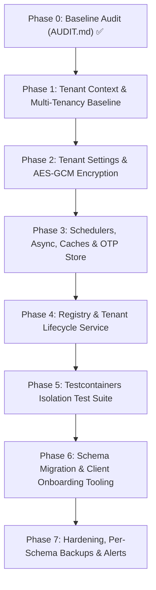

# Multi-Tenancy Architecture Audit (AUDIT.md)
**Phase 0: Baseline Codebase Audit for Dual-Mode (Shared & Dedicated) Schema-per-Tenant Conversion**
*Date: November 2026 | Branch: `phase-0-audit` | Target: Java 23, Spring Boot 3.2.5, PostgreSQL 18, Hibernate 6.4, Flyway*

---

## 1. Executive Summary & Audit Scope

This audit maps every location in the **PG CRM Core** codebase where tenant-specific state, configuration, execution context, or credentials reside. It establishes the baseline gap analysis required to transition from a single-tenant physical database model to a dual-mode codebase:
1. **Shared Mode**: One application instance and one PostgreSQL database serving multiple tenants via PostgreSQL schema isolation (`t_<slug>`), with a `platform` registry schema and request-host-based tenant resolution.
2. **Dedicated Mode**: The exact same Docker image running for a single tenant on its own database, pinned to `app.dedicated-tenant=<slug>` and bypassing host-based resolution.

> [!IMPORTANT]
> **Strict Isolation Constraint**: Isolation is achieved strictly by PostgreSQL schemas (`SET search_path TO t_<slug>, public`). **No `tenant_id` discriminator columns** will be added to any business entity table.

---

## 2. Repositories and Native Queries

### 2.1 Repository Inventory (17 Spring Data JPA Repositories)
All repositories in `com.pgcrm.repository` operate via Spring Data JPA interfaces extending `JpaRepository`:

| Repository | Entity | Custom Queries | Native Queries (`nativeQuery = true`) | Schema References |
| :--- | :--- | :--- | :--- | :--- |
| `AuditLogRepository` | `AuditLog` | JPQL (`@Query`) | ❌ None | ❌ None (Unqualified entity) |
| `BedRepository` | `Bed` | JPQL (`@Query`) | ❌ None | ❌ None |
| `BlockRepository` | `Block` | Derived methods | ❌ None | ❌ None |
| `BuildingConfigRepository` | `BuildingConfig` | Derived methods | ❌ None | ❌ None |
| `BuildingRepository` | `Building` | Derived methods | ❌ None | ❌ None |
| `DailyLogRepository` | `DailyLog` | Derived methods | ❌ None | ❌ None |
| `EbBillGuestRepository` | `EbBillGuest` | Derived methods | ❌ None | ❌ None |
| `EbBillRepository` | `EbBill` | Derived methods | ❌ None | ❌ None |
| `FloorRepository` | `Floor` | Derived methods | ❌ None | ❌ None |
| `GuestRepository` | `Guest` | JPQL (`@Query`) | ❌ None | ❌ None |
| `InvoiceRepository` | `Invoice` | JPQL (`@Query`) | ❌ None | ❌ None |
| `MaintenanceTicketRepository` | `MaintenanceTicket` | Derived methods | ❌ None | ❌ None |
| `MeterReadingRepository` | `MeterReading` | Derived methods | ❌ None | ❌ None |
| `NotificationRepository` | `Notification` | Derived methods | ❌ None | ❌ None |
| `PricingConfigRepository` | `PricingConfig` | Derived methods | ❌ None | ❌ None |
| `RoomRepository` | `Room` | Derived methods | ❌ None | ❌ None |
| `UserRepository` | `User` | JPQL (`@Query`) | ❌ None | ❌ None |

### 2.2 Native Query and Direct JDBC Audit
- **Production Code**: **Zero (0)** native SQL queries (`nativeQuery = true`) exist in any production repository or service. All database interaction is routed through Hibernate JPQL queries that reference entity names rather than physical tables.
- **Test Code**: `src/test/java/com/pgcrm/integration/QaMultiBedCheckInTest.java` uses `JdbcTemplate` for post-test table row cleanup (`DELETE FROM guest_beds...`).
- **Audit Conclusion**: Because all entity mappings use unqualified table names (`@Table(name = "invoices")`), Hibernate will emit SQL targeting tables in whatever schema is active on the PostgreSQL connection `search_path`. No repository query requires refactoring to remove hardcoded schema prefixes.

---

## 3. Background Schedulers (`@Scheduled`)

Four background jobs currently run in the single-tenant core. In multi-tenant shared mode, each scheduler must be wrapped in a tenant loop that iterates through all `ACTIVE` tenants from `platform.tenants`, sets `TenantContext`, executes inside a per-tenant `try-catch`, and clears `TenantContext` in a `finally` block.

| Scheduler Class | Cron Expression | Purpose | Current Single-Tenant Logic | Multi-Tenant Requirement & Idempotency |
| :--- | :--- | :--- | :--- | :--- |
| `MonthlyBillingScheduler` | `0 0 0 1 * *`<br>(Midnight, 1st of month) | Generates monthly invoices for previous month | Calls `guestRepository.findByActiveTrue()` | **Loop over ACTIVE tenants**.<br>Idempotent via `invoiceRepository.findByGuestIdAndMonthAndYear()` duplicate guard. |
| `OverdueInvoiceScheduler` | `0 0 0 * * *`<br>(Midnight daily) | Marks past-due invoices as `OVERDUE` | Calls `invoiceRepository.findOverdueEligibleInvoices(today)` | **Loop over ACTIVE tenants**.<br>Idempotent: updates only status in `('GENERATED', 'PENDING_CASH_VERIFICATION')`. |
| `PaymentReminderScheduler` | `0 0 9 * * *`<br>(9:00 AM daily) | Dispatches email + WhatsApp payment reminders | Calls `invoiceRepository.findUnpaidInvoicesDueBy(cutoff)` | **Loop over ACTIVE tenants**.<br>Idempotent: filters by `reminderSentAt IS NULL` and stamps timestamp. |
| `DataRetentionScheduler` | `0 0 3 * * ?`<br>(3:00 AM daily) | Anonymizes PII of guests checked out >365 days | Calls `guestRepository.anonymizeExpiredGuests(cutoffDate)` | **Loop over ACTIVE tenants**.<br>Idempotent: filters by `isAnonymized = false`. |

---

## 4. Asynchronous Processing (`@Async`) & Concurrency

- **Current State**: `@Async` is not currently declared on any service method in `src/main/java/com/pgcrm`.
- **Future Concurrency & Thread Pool Requirement**:
  - Whenever Spring's `@Async`, `TaskExecutor`, or `CompletableFuture` is utilized, a custom `TaskDecorator` must be implemented.
  - The `TenantAwareTaskDecorator` will capture `TenantContext.getCurrentTenant()` and SLF4J `MDC` from the calling web/scheduling thread, apply them in the worker thread, and clear them inside a `finally` block to prevent thread pool contamination.

---

## 5. Caches and In-Memory State

### 5.1 Spring Cache / Caffeine (`CacheConfig.java`)
`CacheConfig.java` declares two Caffeine caches with a 5-minute TTL:
1. `systemConfig` (maximum size 500)
2. `buildings` (maximum size 500)

**Identified Cache Vulnerabilities**:
- `InventoryController.java:29`: `@Cacheable(value = "buildings")` on `getBuildings()`.
- `SystemConfigController.java:20`: `@Cacheable(value = "systemConfig")` on `getConfig()`.

> [!CAUTION]
> **Cross-Tenant Data Leak Risk**: Currently, cache keys are evaluated without a tenant prefix. In shared mode, Tenant B calling `getBuildings()` would receive Tenant A's cached buildings!
>
> **Action Required**:
> 1. In Phase 3, implement a custom `KeyGenerator` (or custom cache resolver) that prepends `TenantContext.getTenantSlug()` to every cache key: `key = "tenantSlug + ':' + #key"`.
> 2. Alternatively, eliminate global caching for tenant-specific entities or use tenant-partitioned cache namespaces.

---

## 6. OTP and In-Memory Verification Store

### 6.1 `EmailVerificationService.java`
- **Current Implementation**:
  ```java
  private final Map<String, VerificationDetails> cache = new ConcurrentHashMap<>();
  // Keyed strictly by userId:
  public void storeCode(final String userId, final String newEmail, final String code)
  public boolean verifyCode(final String userId, final String newEmail, final String code)
  ```
- **Vulnerability**: If user IDs collide across tenants or an attacker attempts cross-tenant verification injection, single-node in-memory store lacks tenant isolation.
- **Action Required (Section 6 Rule)**:
  Key the internal map by compound key: `TenantContext.getTenantSlug() + ":" + userId`.

---

## 7. File Storage, Uploads, and Paths

| Component / Flow | Storage Mechanism | Tenant Isolation Impact | Action Required |
| :--- | :--- | :--- | :--- |
| `InvoicePdfService.java` | In-memory `ByteArrayOutputStream` streamed directly to client HTTP response (`byte[]`). | No disk file stored. | Safe. Ensure branding name in PDF header is read from `TenantSettingsService`. |
| `GuestImportController.java`<br>`BulkImportService.java` | `MultipartFile` parsed in-memory via Apache POI `InputStream`. | No disk file stored. | Safe. Parsed guests are saved via JPA into current connection schema. |
| `Guest.idProofUrl` | String field representing document URL. | If local filesystem upload is implemented, files must be partitioned. | Prefix disk paths: `uploads/{tenant_slug}/id_proofs/{filename}`. |
| Static Frontend Files | Served from `classpath:static/` or Nginx Docker container. | Generic static assets (React bundle, icons, manifest). | Safe. Tenant dynamic theme & branding is fetched via `/api/config/public`. |

---

## 8. Environment Variables and `@Value` Annotations

Every per-client value currently injected via environment variables or `@Value` must be audited. In Phase 2, per-tenant settings move to `t_<slug>.tenant_settings` with AES-GCM encryption for secrets.

| Config Key | Code Location | Category | Target Multi-Tenant Handling |
| :--- | :--- | :--- | :--- |
| `app.jwt.secret` | `JwtUtil.java:18` | **Global Platform** | Stays in environment. **One global JWT secret**; tenant slug added as a claim in every token. |
| `app.jwt.access-token-expiration` | `JwtUtil.java:21` | **Global Platform** | Stays in environment (15 min). |
| `app.jwt.refresh-token-expiration` | `JwtUtil.java:24` | **Global Platform** | Stays in environment (7 days). |
| `app.cors.allowed-origins` | `SecurityConfig.java:42` | **Global Platform** | Stays in environment / config. |
| `DB_WIPE_ON_STARTUP` | `FlywayConfig.java:25` | **Global Platform** | Stays in environment (`dev/test` profile only). |
| `app.seed-demo` | `DataSeeder.java:59` | **Global Platform** | Controls whether demo data seeds in dev mode. |
| `pg.default-owner.*` | `DatabaseSeeder.java:27-33` | **Seed Data** | Only used for dev seed; in multi-tenant, tenant owner is provisioned per tenant. |
| `razorpay.key-id` | `PaymentService.java:63` | **Per-Tenant Setting** | **Move to `tenant_settings.razorpay_key_id`**. |
| `razorpay.key-secret` | `PaymentService.java:67` | **Per-Tenant Secret** | **Move to `tenant_settings.razorpay_key_secret` (AES-GCM encrypted)**. |
| `razorpay.enabled` | `PaymentService.java:74` | **Per-Tenant Setting** | Derived from presence of tenant Razorpay keys. |
| `razorpay.webhook-secret` | *Missing in core* | **Per-Tenant Secret** | **Add to `tenant_settings.razorpay_webhook_secret` (AES-GCM encrypted)**. |
| `meta.whatsapp.phone-number-id` | `MetaWhatsAppConfig.java:11` | **Per-Tenant Setting** | **Move to `tenant_settings.whatsapp_phone_number_id`**. |
| `meta.whatsapp.access-token` | `MetaWhatsAppConfig.java:14` | **Per-Tenant Secret** | **Move to `tenant_settings.whatsapp_access_token` (AES-GCM encrypted)**. |
| `meta.whatsapp.verify-token` | `MetaWhatsAppConfig.java:17` | **Per-Tenant Secret** | **Move to `tenant_settings.whatsapp_verify_token` (AES-GCM encrypted)**. |
| `app.mail.from` | `EmailService.java:60` | **Per-Tenant / System** | Default fallback system email or tenant configurable sender. |
| `app.mail.from-name` | `EmailService.java:64` | **Per-Tenant Setting** | **Move to `tenant_settings.branding_name`**. |
| `pg.system.branding.name` | `SystemConfigProperties.java:22` | **Per-Tenant Setting** | **Move to `tenant_settings.branding_name`**. |
| `pg.system.branding.short-title`| `SystemConfigProperties.java:23` | **Per-Tenant Setting** | **Move to `tenant_settings.branding_short_name`**. |
| `pg.system.branding.primary-color` | `SystemConfigProperties.java:24` | **Per-Tenant Setting** | **Move to `tenant_settings.branding_primary_color`**. |

---

## 9. Flyway Migration History & Schema Layout

### 9.1 Existing Migration Directory (`db/migration/`)
Current migrations `V1` through `V18` define the single-tenant schema in PostgreSQL `public`.
- `V1__init_schema.sql`: Core entity tables (`users`, `buildings`, `floors`, `blocks`, `rooms`, `beds`, `guests`, `invoices`, `invoice_line_items`, `eb_bills`, `eb_bill_guests`, `daily_logs`, `audit_logs`, `maintenance_tickets`, `notifications`).
- `V2__drop_multi_tenant.sql`: Dropped previous legacy multi-tenant discriminator columns and obsolete tables.
- `V3` - `V18`: Added soft deletes, `building_configs`, cutoff times, payment mode configs, notification user associations, bed switch audit action, invoice status constraints, AC and addon toggles, multi-bed relationships, check-in timestamps, PII anonymization, meal plan and meter readings, custom addon labels, super admin RBAC flags, and overdue audit action.

### 9.2 Target Multi-Tenant Migration Structure
To comply with Section 4 of the specification:
```
src/main/resources/db/migration/
├── platform/
│   └── V1__init_platform.sql
│       ├── CREATE TABLE platform.tenants (id, slug, display_name, schema_name, plan, status, created_at, renewal_date);
│       └── CREATE TABLE platform.tenant_domains (host, tenant_id REFERENCES platform.tenants(id));
└── tenant/
    ├── V1__init_tenant_schema.sql (Consolidated baseline of V1-V18 business tables)
    └── V2__create_tenant_settings.sql (tenant_settings table with AES-GCM encrypted columns)
```
- **Rule Verification**: Zero control-plane migrations (e.g., subscriptions, tenant profiles, AMC reminders) remain.

---

## 10. Control Plane Removal Verification

A complete project-wide scan was executed across all tracked `.java`, `.yml`, `.sql`, `.xml`, and `.md` files for legacy terms (`control-plane`, `CONTROL_PLANE`, `master-control-plane`, `controlplane_db`, `provision_tenant`, `AmcReminder`, `TenantOnboarding`, `TenantProvisioning`, `SUPER_SUPER_ADMIN`):
- **Matches Found**: **0 (Zero)**.
- **Verification Status**: ✅ Clean. The Control Plane is completely removed from the workspace.

---

## 11. Implementation Action Plan by Phase



1. **Phase 1 (Next Step)**:
   - Create branch `phase-1-tenant-context`.
   - Implement `TenantContext`, `TenantResolutionFilter`, `MultiTenantConnectionProvider`, and `CurrentTenantIdentifierResolver`.
   - Separate Flyway migrations into `db/migration/platform` and `db/migration/tenant`.
   - Support `app.deployment-mode=dedicated` (running as single tenant) and ensure all 49 existing test cases pass cleanly.
2. **Phase 2**:
   - Create `tenant_settings` table in tenant schemas.
   - Implement `TenantSettingsService` and AES-GCM encryption helper for secrets.
   - Decouple `PaymentService`, `MetaWhatsAppConfig`, and `PublicConfigController` from environment variables.
3. **Phase 3**:
   - Refactor the 4 `@Scheduled` jobs to loop over all `ACTIVE` tenants with per-tenant isolation.
   - Tenant-scope Caffeine cache keys and OTP store (`EmailVerificationService`).
4. **Phase 4**:
   - Implement Platform Admin API (`/platform/api/**`) and CLI for tenant provisioning with automated rollback.
5. **Phase 5**:
   - Execute the complete Testcontainers isolation test suite.

---
*Audit completed with zero code changes in accordance with Phase 0 rules.*
