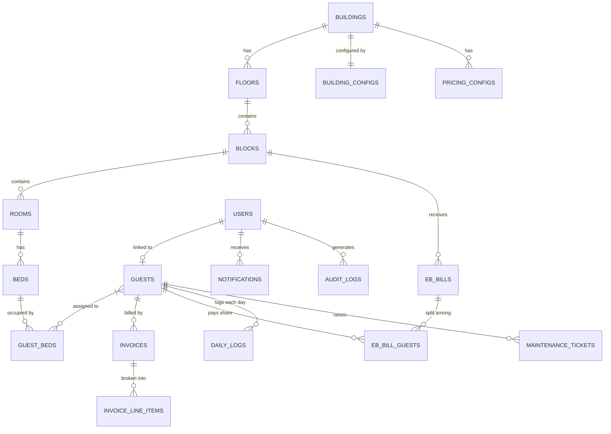

# PG CRM — Data Model Reference
### Complete Entity Relationship & Database Schema Guide

> [!NOTE]
> This document is the authoritative reference for the PG CRM database schema.
> All schema changes must go through Flyway migrations — never modify existing migration files.

---

## 1. PG-CORE Entity Relationship Diagram



---

## 2. Spatial Hierarchy

```
Building
  └── Floor (e.g., Ground Floor, 1st Floor)
        └── Block (e.g., Block A, Block B)
              └── Room (e.g., 3-sharing AC Room)
                    └── Bed (e.g., Bed 1, Bed 2, Bed 3)
```

The full hierarchy is cascaded — deleting a Building cascades to all Floors, Blocks, Rooms, and Beds.

---

## 3. Table Definitions

### 3.1 `buildings`

| Column | Type | Constraints | Description |
| :--- | :--- | :--- | :--- |
| `id` | `UUID` | `PK` | Auto-generated UUID |
| `name` | `VARCHAR(255)` | `NOT NULL UNIQUE` | Display name of the building |
| `address` | `VARCHAR(500)` | nullable | Physical street address |
| `created_at` | `TIMESTAMP` | auto-set on create | Record creation time |

---

### 3.2 `building_configs`

One-to-one with `buildings`. Shares the same UUID primary key.

| Column | Type | Default | Description |
| :--- | :--- | :--- | :--- |
| `building_id` | `UUID` | `PK, FK → buildings.id` | Shared PK |
| `food_included_in_rent` | `BOOLEAN` | `false` | If true, meals are not billed separately |
| `allow_meal_cancellation` | `BOOLEAN` | `true` | Guests can cancel opted-in meals |
| `eb_split_method` | `VARCHAR(50)` | `EQUAL_SPLIT` | Enum: `EQUAL_SPLIT`, `PER_BED`, `METER_BASED`, `MANAGER_MANUAL` |
| `breakfast_price` | `NUMERIC(10,2)` | `0` | Per-meal breakfast price |
| `lunch_price` | `NUMERIC(10,2)` | `0` | Per-meal lunch price |
| `dinner_price` | `NUMERIC(10,2)` | `0` | Per-meal dinner price |
| `omelette_price` | `NUMERIC(10,2)` | `0` | Per-omelette price |
| `boiled_egg_price` | `NUMERIC(10,2)` | `0` | Per-boiled-egg price |
| `washing_machine_price` | `NUMERIC(10,2)` | `0` | Per washing machine use |
| `breakfast_cutoff_time` | `TIME` | `07:30` | Deadline to opt out of breakfast |
| `dinner_cutoff_time` | `TIME` | `18:00` | Deadline to opt out of dinner |
| `is_previous_day` | `BOOLEAN` | `false` | Cutoff applies to the previous day's booking window |
| `notice_period_days` | `INTEGER` | `30` | Days of notice required before checkout |
| `payment_due_day_of_month` | `INTEGER` | `10` | Day of month when invoices become due |
| `allow_upi` | `BOOLEAN` | `true` | UPI payment mode allowed |
| `allow_cash` | `BOOLEAN` | `true` | Cash payment mode allowed |
| `allow_netbanking` | `BOOLEAN` | `false` | Net banking allowed |
| `allow_razorpay` | `BOOLEAN` | `false` | Online Razorpay payment allowed |
| `billing_scheduler_enabled` | `BOOLEAN` | `true` | Enable/disable automatic monthly billing cron |
| `ac_available` | `BOOLEAN` | `false` | Building has AC rooms |

---

### 3.3 `floors`

| Column | Type | Constraints | Description |
| :--- | :--- | :--- | :--- |
| `id` | `UUID` | `PK` | Auto-generated UUID |
| `floor_number` | `INTEGER` | `NOT NULL` | Floor level (0 = Ground) |
| `name` | `VARCHAR(100)` | nullable | Display name (e.g., "First Floor") |
| `building_id` | `UUID` | `FK → buildings.id` | Parent building |

---

### 3.4 `blocks`

| Column | Type | Constraints | Description |
| :--- | :--- | :--- | :--- |
| `id` | `UUID` | `PK` | Auto-generated UUID |
| `name` | `VARCHAR(100)` | `NOT NULL` | Block label (e.g., "Block A") |
| `floor_id` | `UUID` | `FK → floors.id` | Parent floor |

---

### 3.5 `rooms`

| Column | Type | Constraints | Description |
| :--- | :--- | :--- | :--- |
| `id` | `UUID` | `PK` | Auto-generated UUID |
| `room_number` | `VARCHAR(20)` | `NOT NULL` | Room identifier (e.g., "101") |
| `sharing_type` | `INTEGER` | `NOT NULL` | Number of beds (1/2/3/4) |
| `is_ac` | `BOOLEAN` | `false` | Whether room has AC |
| `base_rent` | `NUMERIC(10,2)` | `NOT NULL` | Base monthly rent per bed |
| `block_id` | `UUID` | `FK → blocks.id` | Parent block |

---

### 3.6 `beds`

| Column | Type | Constraints | Description |
| :--- | :--- | :--- | :--- |
| `id` | `UUID` | `PK` | Auto-generated UUID |
| `bed_label` | `VARCHAR(20)` | `NOT NULL` | Bed label (e.g., "Bed 1") |
| `status` | `VARCHAR(20)` | `NOT NULL DEFAULT 'VACANT'` | Enum: `VACANT`, `OCCUPIED` |
| `room_id` | `UUID` | `FK → rooms.id` | Parent room |

---

### 3.7 `users`

| Column | Type | Constraints | Description |
| :--- | :--- | :--- | :--- |
| `id` | `UUID` | `PK` | Auto-generated UUID |
| `email` | `VARCHAR(255)` | `NOT NULL UNIQUE` | Login credential |
| `password` | `VARCHAR(255)` | `NOT NULL` | BCrypt hash |
| `role` | `VARCHAR(20)` | `NOT NULL` | Enum: `GUEST`, `PG_MANAGER`, `PG_OWNER`, `SUPER_ADMIN` |
| `active` | `BOOLEAN` | `NOT NULL DEFAULT true` | Whether account is enabled |
| `must_change_password` | `BOOLEAN` | `NOT NULL DEFAULT true` | Force password change on next login |
| `branch_id` | `VARCHAR(500)` | nullable | Comma-separated building UUIDs (for managers) |
| `allow_super_admin_access` | `BOOLEAN` | `NOT NULL DEFAULT false` | Owner Permission Guard flag |
| `email_verified` | `BOOLEAN` | `NOT NULL DEFAULT false` | Email OTP verification status |
| `created_at` | `TIMESTAMP` | auto-set | Record creation time |

---

### 3.8 `guests`

| Column | Type | Constraints | Description |
| :--- | :--- | :--- | :--- |
| `id` | `UUID` | `PK` | Auto-generated UUID |
| `is_deleted` | `BOOLEAN` | `NOT NULL DEFAULT false` | Soft delete flag |
| `full_name` | `VARCHAR(255)` | `NOT NULL` | Guest's full name (anonymized after 365 days post-checkout) |
| `phone` | `VARCHAR(20)` | nullable | Phone number (anonymized after 365 days post-checkout) |
| `kyc_status` | `VARCHAR(20)` | `NOT NULL` | Enum: `PENDING`, `VERIFIED`, `REJECTED` |
| `active` | `BOOLEAN` | `NOT NULL DEFAULT true` | Whether guest is currently checked in |
| `check_in_date` | `DATE` | `NOT NULL` | Official check-in date |
| `check_in_time` | `TIME` | nullable | Optional precise check-in time |
| `notice_date` | `DATE` | nullable | Date notice was issued |
| `exit_date` | `DATE` | nullable | Computed exit date (noticeDate + noticePeriodDays) |
| `actual_check_out_date` | `DATE` | nullable | Actual checkout date |
| `monthly_rent` | `NUMERIC(10,2)` | `NOT NULL` | Fixed flat-rate monthly rent |
| `deposit_amount` | `NUMERIC(10,2)` | nullable | Security deposit paid |
| `is_book_entire_room` | `BOOLEAN` | `NOT NULL DEFAULT false` | Whole Room Booking flag |
| `breakfast_preference` | `BOOLEAN` | `DEFAULT true` | Default breakfast opt-in |
| `lunch_preference` | `BOOLEAN` | `DEFAULT false` | Default lunch opt-in |
| `dinner_preference` | `BOOLEAN` | `DEFAULT true` | Default dinner opt-in |
| `veg_preference` | `BOOLEAN` | `DEFAULT true` | Vegetarian preference |
| `meal_plan_enabled` | `BOOLEAN` | `DEFAULT true` | Whether meal plan is active |
| `anonymized_at` | `TIMESTAMP` | nullable | When PII was anonymized |
| `user_id` | `UUID` | `FK → users.id` | Associated login user |

---

### 3.9 `guest_beds` (Junction Table)

| Column | Type | Description |
| :--- | :--- | :--- |
| `guest_id` | `UUID, FK → guests.id` | Guest reference |
| `bed_id` | `UUID, FK → beds.id` | Bed reference |

A guest can occupy multiple beds (Whole Room Booking scenario).

---

### 3.10 `invoices`

| Column | Type | Constraints | Description |
| :--- | :--- | :--- | :--- |
| `id` | `UUID` | `PK` | Auto-generated UUID |
| `is_deleted` | `BOOLEAN` | `NOT NULL DEFAULT false` | Soft delete flag |
| `billing_month` | `INTEGER` | `NOT NULL` | 1–12 |
| `billing_year` | `INTEGER` | `NOT NULL` | e.g., 2026 |
| `total_amount` | `NUMERIC(12,2)` | `NOT NULL` | Sum of all line items |
| `status` | `VARCHAR(50)` | `NOT NULL` | Enum: `GENERATED`, `PENDING_CASH_VERIFICATION`, `PAID`, `OVERDUE` |
| `generated_at` | `TIMESTAMP` | auto-set | When invoice was created |
| `due_date` | `DATE` | nullable | Payment due date |
| `paid_at` | `TIMESTAMP` | nullable | When payment was confirmed |
| `payment_method` | `VARCHAR(50)` | nullable | `UPI`, `CASH`, `CARD`, `NETBANKING` |
| `razorpay_order_id` | `VARCHAR(100)` | nullable | Razorpay order reference |
| `razorpay_payment_id` | `VARCHAR(100)` | nullable | Razorpay payment reference |
| `guest_id` | `UUID` | `FK → guests.id` | Associated guest |

---

### 3.11 `invoice_line_items`

| Column | Type | Description |
| :--- | :--- | :--- |
| `id` | `UUID` | PK |
| `type` | `VARCHAR(50)` | Enum: `RENT`, `FOOD`, `EB_BILL`, `LAUNDRY`, `ADDON`, `OPENING_ARREARS` |
| `description` | `VARCHAR(255)` | Human-readable line item description |
| `quantity` | `NUMERIC(10,2)` | Quantity (meals count, days, etc.) |
| `unit_price` | `NUMERIC(10,2)` | Price per unit |
| `amount` | `NUMERIC(12,2)` | `quantity × unit_price` |
| `invoice_id` | `UUID` | FK → invoices.id |

---

### 3.12 `eb_bills`

| Column | Type | Description |
| :--- | :--- | :--- |
| `id` | `UUID` | PK |
| `billing_period_start` | `DATE` | Start of EB billing period |
| `billing_period_end` | `DATE` | End of EB billing period |
| `total_amount` | `NUMERIC(12,2)` | Total electricity bill for the block |
| `split_method` | `VARCHAR(50)` | Algorithm used (preserved for history) |
| `recorded_at` | `TIMESTAMP` | When bill was recorded |
| `block_id` | `UUID` | FK → blocks.id |
| `recorded_by_user_id` | `UUID` | FK → users.id (manager who recorded) |

---

### 3.13 `eb_bill_guests`

| Column | Type | Description |
| :--- | :--- | :--- |
| `id` | `UUID` | PK |
| `share_amount` | `NUMERIC(10,2)` | This guest's share of the EB bill |
| `meter_previous_reading` | `NUMERIC(10,3)` | Sub-meter reading (METER_BASED only) |
| `meter_current_reading` | `NUMERIC(10,3)` | Sub-meter reading (METER_BASED only) |
| `eb_bill_id` | `UUID` | FK → eb_bills.id |
| `guest_id` | `UUID` | FK → guests.id |

---

### 3.14 `daily_logs`

| Column | Type | Description |
| :--- | :--- | :--- |
| `id` | `UUID` | PK |
| `log_date` | `DATE` | The calendar date of the log |
| `breakfast` | `BOOLEAN` | Guest had breakfast |
| `lunch` | `BOOLEAN` | Guest had lunch |
| `dinner` | `BOOLEAN` | Guest had dinner |
| `omelette_count` | `INTEGER` | Number of omelettes |
| `boiled_egg_count` | `INTEGER` | Number of boiled eggs |
| `laundry_count` | `INTEGER` | Number of laundry uses |
| `is_locked` | `BOOLEAN` | Log locked after cutoff time |
| `guest_id` | `UUID` | FK → guests.id |

---

### 3.15 `maintenance_tickets`

| Column | Type | Description |
| :--- | :--- | :--- |
| `id` | `UUID` | PK |
| `title` | `VARCHAR(255)` | Short description |
| `description` | `TEXT` | Detailed description |
| `status` | `VARCHAR(30)` | Enum: `OPEN`, `IN_PROGRESS`, `RESOLVED` |
| `priority` | `VARCHAR(20)` | Enum: `LOW`, `MEDIUM`, `HIGH` |
| `created_at` | `TIMESTAMP` | Submission time |
| `resolved_at` | `TIMESTAMP` | Resolution time |
| `guest_id` | `UUID` | FK → guests.id (submitter) |
| `resolved_by_user_id` | `UUID` | FK → users.id (manager who resolved) |

---

### 3.16 `audit_logs`

| Column | Type | Description |
| :--- | :--- | :--- |
| `id` | `UUID` | PK |
| `action` | `VARCHAR(100)` | Enum value from `AuditAction` |
| `entity_type` | `VARCHAR(50)` | Entity type (e.g., `GUEST`, `INVOICE`) |
| `entity_id` | `VARCHAR(100)` | ID of affected entity |
| `description` | `TEXT` | Human-readable audit description |
| `performed_at` | `TIMESTAMP` | When action occurred |
| `performed_by_user_id` | `UUID` | FK → users.id |

---

## 4. Enum Reference

### PG-CORE Enums

```java
// Role
GUEST, PG_MANAGER, PG_OWNER, SUPER_ADMIN

// BedStatus
VACANT, OCCUPIED

// EbSplitMethod
EQUAL_SPLIT,    // Total / active guest count
PER_BED,        // Fixed rate × bed count
METER_BASED,    // (currentReading - previousReading) × ratePerUnit
MANAGER_MANUAL  // Manager enters each guest's amount manually

// InvoiceStatus
GENERATED,               // Created, awaiting payment
PENDING_CASH_VERIFICATION, // Cash submitted, awaiting manager confirm
PAID,                    // Payment verified
OVERDUE                  // Due date passed, unpaid

// KycStatus
PENDING, VERIFIED, REJECTED

// MaintenanceStatus
OPEN, IN_PROGRESS, RESOLVED

// MaintenancePriority
LOW, MEDIUM, HIGH

// InvoiceLineType
RENT, FOOD, EB_BILL, LAUNDRY, ADDON, OPENING_ARREARS
```

---

## 5. Soft Delete Pattern

Guest and Invoice entities use Hibernate's `@SQLDelete` and `@SQLRestriction` for soft deletes:

```sql
-- What Hibernate executes instead of DELETE
UPDATE guests SET is_deleted = true WHERE id = ?

-- Hibernate automatically appends this WHERE clause on all SELECTs
SELECT * FROM guests WHERE is_deleted = false AND ...
```

This means:
- All `guestRepository.findAll()` queries automatically exclude deleted records.
- `guestRepository.findById(id)` returns empty if the record is soft-deleted.
- Financial records linked to soft-deleted guests are preserved.
