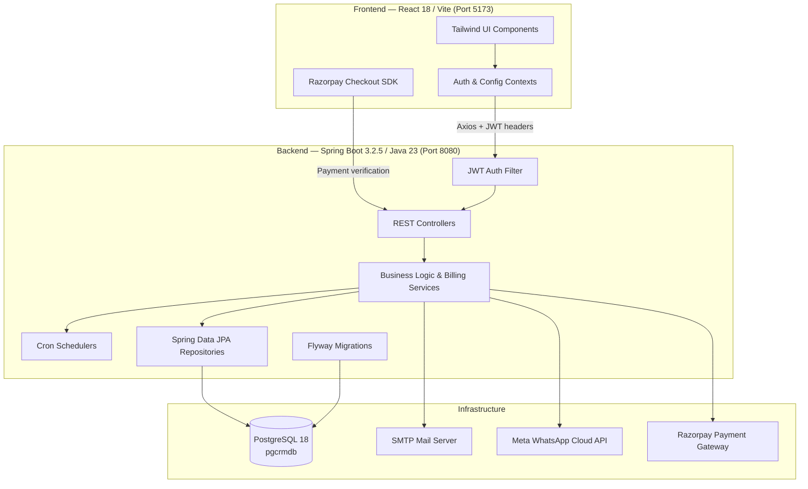

# PG CRM System Architecture

This document defines the system architecture for the **PG CRM** Paying Guest & Hostel Management Platform.

---

## 1. System Overview & Dual-Mode Deployment

PG CRM is a dual-mode property management application designed to run from a single unified codebase in two distinct deployment topologies:

1. **Shared Mode (`app.deployment-mode=shared`)**: A single application instance and a single PostgreSQL database serve multiple PG owners (tenants). Each tenant has its own isolated PostgreSQL schema (`t_<slug>`). Tenant data is physically separated by schema; there are **no `tenant_id` discriminator columns**. A lightweight `platform` schema holds only the tenant registry and domain mappings.
2. **Dedicated Mode (`app.deployment-mode=dedicated`)**: The exact same Docker image runs for a single tenant on its own server/container and database, pinned via `app.dedicated-tenant=<slug>`. Host-based resolution is ignored, and the application operates exclusively within that tenant's schema.

A tenant can migrate seamlessly from Shared to Dedicated by exporting their schema (`pg_dump --schema=t_<slug>`) and restoring it on a dedicated instance without code changes or forks.

### Spatial Hierarchy

```
Building → Floor → Block → Room → Bed
```

Each property is modelled as a hierarchical tree. A `Building` contains `Floor`s, each `Floor` contains `Block`s or `Room`s directly, each `Room` contains `Bed`s. Bed occupancy states are `VACANT`, `OCCUPIED`, and `UNDER_NOTICE`.

### Architecture & Isolation Model

- **Database Schemas**:
  - `platform`: Holds `tenants` (registry) and `tenant_domains` (host mappings). Never contains tenant operational data.
  - `t_<slug>`: Dedicated schema per tenant containing all business entity tables (`users`, `guests`, `buildings`, `invoices`, `tenant_settings`, etc.).
- **Tenant Switching**: Done per connection from a single Hikari connection pool using PostgreSQL's `SET search_path TO t_<slug>, public`. On connection release, `search_path` is reset to `platform, public` to eliminate cross-tenant connection leaks.
- **Tenant Resolution**: Handled by `TenantResolutionFilter` before Spring Security. Resolves tenant by request `Host` header (subdomain `sri-sai.<base-domain>` or custom domain) in shared mode, or returns `app.dedicated-tenant` in dedicated mode. Fails closed (404 for unknown host, 403 for suspended).

---

## 2. Role & Access Model

The application enforces a strict Role-Based Access Control (RBAC) hierarchy with four roles:

| Role | Platform Tier | Access Scope & Responsibilities |
| :--- | :--- | :--- |
| `GUEST` | Tier 1 — Resident | Self-service portal: view check-in details, meal calendars, invoices, payment history, and submit maintenance requests. |
| `PG_MANAGER` | Tier 2 — Branch Admin | Property operations: guest check-in/checkout, daily meal logs, electricity bill splits, invoice generation, maintenance ticket resolution. |
| `PG_OWNER` | Tier 3 — Global Admin | Enterprise management: building/room/bed setup, manager account management, pricing configuration, revenue reports. |
| `SUPER_ADMIN` | Tier 4 — System Admin | Infrastructure operations: system-level configuration, whitelabel settings, production deployment management. |

RBAC is enforced at the Spring Security layer. See [AGENTS.md](file:///e:/PG-Project/AGENTS.md) for the full URL-to-role mapping table.

---

## 3. Tech Stack



**Backend stack**: Java 23, Spring Boot 3.2.5, Spring Security, Spring Data JPA, Hibernate, Flyway, OpenPDF, Thymeleaf, Lombok.

**Frontend stack**: React 18, Vite, Tailwind CSS, Axios, Razorpay SDK.

---

## 4. Key Business Logic

### 4.1 Flat-Rate Billing Model

PG CRM uses a **flat-rate monthly billing** model — no daily proration for active guests:

- **Standard Bed**: `Charge = guest.getMonthlyRent()`
- **Whole Room Booking**: `Charge = guest.getMonthlyRent() × room.getSharingType()`

If a guest is active for any part of a billing month, they are billed the full monthly rate. This is enforced by `MonthlyBillingScheduler`.

### 4.2 Electricity Bill (EB) Split Methods

The EB split method is configured per building via `BuildingConfig.getEbSplitMethod()`:

| Method | Formula |
| :--- | :--- |
| `EQUAL_SPLIT` | `perGuestShare = totalBillAmount / activeGuestCount` |
| `PER_BED` | `perGuestShare = fixedRatePerBed × guestBedCount` |
| `METER_BASED` | `perGuestShare = (currentReading − previousReading) × ratePerUnit` |
| `MANAGER_MANUAL` | Manager enters each guest's amount individually via the UI |

### 4.3 PII Anonymization Scheduler

Guests who have been checked out for more than **365 days** are automatically anonymized by `DataRetentionScheduler`:

- `fullName` → replaced with a random token
- `phone` → replaced with a random token
- **Financial records, invoices, and audit logs are preserved — never deleted**

Scheduler runs daily at **3:00 AM** (`0 0 3 * * ?`).

---

## 5. Security Architecture

### 5.1 JWT Authentication Flow

1. Client POSTs credentials to `/api/auth/login`.
2. Backend verifies BCrypt password hash and issues:
   - **Access Token** (15-minute expiry, HMAC-SHA256 signed)
   - **Refresh Token** (7-day expiry)
3. Client stores tokens in `sessionStorage`.
4. On API calls, the `JwtAuthenticationFilter` validates the Bearer token and extracts role claims.
5. On `401` responses, `AuthContext.jsx` silently POSTs the refresh token to `/api/auth/refresh` and replays the original request.

### 5.2 RBAC URL Patterns

| URL Pattern | Required Role |
| :--- | :--- |
| `/api/auth/**` | Public (except `/api/auth/change-password`) |
| `/api/super-admin/**` | `SUPER_ADMIN` |
| `/api/owner/**` | `PG_OWNER`, `SUPER_ADMIN` |
| `/api/manager/**` | `PG_MANAGER`, `PG_OWNER`, `SUPER_ADMIN` |
| `/api/guest/**` | `GUEST`, `PG_MANAGER`, `PG_OWNER`, `SUPER_ADMIN` |
| `/api/reports/**` | `PG_OWNER`, `PG_MANAGER`, `SUPER_ADMIN` |
| `/api/inventory/**` | `PG_MANAGER`, `PG_OWNER`, `SUPER_ADMIN` |
| `/api/payments/**` | `PG_MANAGER`, `PG_OWNER`, `SUPER_ADMIN` |
| `/api/webhooks/**` | Public (Razorpay webhook) |
| `/api/config/public` | Public (frontend branding) |

### 5.3 Razorpay Webhook HMAC-SHA256 Verification

All incoming Razorpay webhook payloads are cryptographically verified before processing:

$$\text{Expected Signature} = \text{HMAC-SHA256}(\text{rawPayload},\ \text{RAZORPAY\_WEBHOOK\_SECRET})$$

If the computed signature does not match the `x-razorpay-signature` header, a `SignatureVerificationException` is thrown (HTTP 400) and the request is rejected.

---

## 6. Scheduler Jobs

| Scheduler Class | Cron Expression | Trigger Time | Purpose |
| :--- | :--- | :--- | :--- |
| `MonthlyBillingScheduler` | `0 0 0 1 * *` | 1st of every month, midnight | Generates arrears rent invoices for all active guests |
| `PaymentReminderScheduler` | `0 0 9 * * *` | Daily at 9:00 AM | Notifies guests and managers of pending unpaid invoices |
| `DataRetentionScheduler` | `0 0 3 * * ?` | Daily at 3:00 AM | Anonymizes PII for guests checked out >365 days |
| `OverdueInvoiceScheduler` | Daily | Daily | Marks invoices past their due date as overdue |

---

## 7. Per-Tenant Settings & Cryptographic Architecture (Phase 2)

Per-client operational settings, branding parameters, and third-party API credentials are fully decoupled from environment variables and persisted in each tenant's dedicated PostgreSQL schema (`t_<slug>.tenant_settings`).

### 7.1 Cryptographic Storage Specification (AES-256-GCM)

All sensitive third-party credentials and webhook secrets are encrypted at rest using AES-GCM before database writes, and decrypted in-memory on demand:

| Parameter | Value / Implementation |
| :--- | :--- |
| **Algorithm** | `AES/GCM/NoPadding` |
| **Key Size** | 256 bits (32 bytes) |
| **Initialization Vector (IV)** | 96 bits (12 bytes), cryptographically random per encryption |
| **Authentication Tag** | 128 bits |
| **Wire / Storage Format** | `v1:<Base64( IV [12 bytes] \|\| Ciphertext + Tag )>` |
| **Master Key Source** | Environment variable `APP_ENCRYPTION_KEY` (never stored in DB or git) |

### 7.2 Decoupled Tenant Configuration Entities

| Field | Category | Security Model | Consumer Services |
| :--- | :--- | :--- | :--- |
| `branding_name` | Branding & UI | Plaintext | `PublicConfigController`, `SystemConfigController`, `InvoicePdfService`, `EmailService` |
| `branding_short_name` | Branding & UI | Plaintext | `PublicConfigController`, `SystemConfigController` |
| `branding_primary_color` | Branding & UI | Plaintext | `PublicConfigController`, `SystemConfigController` |
| `branding_logo_url` | Branding & UI | Plaintext | `PublicConfigController` |
| `razorpay_key_id` | Gateway | Plaintext identifier | `PaymentService`, frontend SDK |
| `razorpay_key_secret` | Gateway Secret | **AES-256-GCM Encrypted** | `PaymentService` (signature verification & order creation) |
| `razorpay_webhook_secret`| Webhook Secret | **AES-256-GCM Encrypted** | `PaymentController` (incoming webhook HMAC verification) |
| `whatsapp_phone_number_id`| Messaging | Plaintext identifier | `MetaWhatsAppConfig`, `WhatsAppService` |
| `whatsapp_access_token` | Messaging Secret | **AES-256-GCM Encrypted** | `MetaWhatsAppConfig`, `WhatsAppService` |
| `whatsapp_verify_token` | Messaging Secret | **AES-256-GCM Encrypted** | `MetaWhatsAppConfig`, webhook verification |
| `notification_email_enabled`| Feature Flag | Boolean | `EmailService` |
| `notification_whatsapp_enabled`| Feature Flag| Boolean | `WhatsAppService` |

---

## 8. Multi-Tenant Jobs, Async, Caching & Security Isolation (Phase 3)

### 8.1 Isolated Multi-Tenant Schedulers (`TenantJobRunner`)

All 4 application schedulers iterate through all `ACTIVE` tenants via `TenantJobRunner`:
1. **Context Management**: For each active tenant, `TenantContext` and SLF4J `MDC("tenant")` are set, and strictly cleared in a `finally` block.
2. **Error Isolation**: Each tenant's task executes inside an independent `try/catch`. An exception during tenant A's processing never aborts or delays tenant B.
3. **Idempotency**: All jobs are idempotent per tenant. Re-running a scheduler on the same day/month will not double-bill, send duplicate reminders, or duplicate overdue state changes.

| Scheduler | Frequency | Target / Action | Multi-Tenant Behaviour |
| :--- | :--- | :--- | :--- |
| `MonthlyBillingScheduler` | `0 0 0 1 * *` | Generates rent invoices for all active guests | Loops active tenants; skips guests with existing invoices for period. |
| `PaymentReminderScheduler` | `0 0 9 * * *` | Sends email/WhatsApp reminders for due invoices | Loops active tenants; skips invoices where `reminderSentAt` is already stamped. |
| `OverdueInvoiceScheduler` | `0 0 0 * * *` | Transitions past-due unpaid invoices to `OVERDUE` | Loops active tenants; queries only non-overdue eligible records. |
| `DataRetentionScheduler` | `0 0 3 * * ?` | Anonymizes PII for guests checked out >365 days | Loops active tenants; updates only records where `anonymized = false`. |

### 8.2 Asynchronous Execution (`@Async`) & Task Decoration

`AsyncConfig` configures a `ThreadPoolTaskExecutor` decorated with `TenantAwareTaskDecorator`. Any task dispatched via `@Async` automatically copies the originating thread's `TenantContext` and `MDC` map into the worker thread, ensuring downstream DB queries use `SET search_path TO t_<slug>, public`, and cleans up all ThreadLocal state upon completion.

### 8.3 In-Memory OTP Store Isolation

`EmailVerificationService` keys pending verification entries as `tenantSlug:userId`. Users sharing identical IDs across different tenant databases cannot collide, overwrite, or validate each other's verification codes.

### 8.4 Cache Key Partitioning

Caches are strictly partitioned by tenant slug to eliminate cross-tenant data leaks:
- `systemConfig`: Keyed by `T(com.pgcrm.multitenancy.TenantContext).getCurrentTenantSlug() ?: 'default'`
- `buildings`: Keyed and evicted by `T(com.pgcrm.multitenancy.TenantContext).getCurrentTenantSlug() ?: 'default'`

### 8.5 Cross-Tenant Token Rejection

- `JwtUtil`: All access and refresh tokens carry a mandatory `tenant` claim holding the issuing tenant slug.
- `JwtAuthenticationFilter`: When a request arrives, the resolved tenant host is compared against the token's `tenant` claim. Any mismatch immediately aborts processing with **HTTP 401 Unauthorized** before reaching controllers.

### 8.6 Per-Tenant Filesystem Isolation

`TenantFileStorageService` enforces directory segregation under `data/storage/{tenantSlug}/` with strict path traversal validation preventing any directory escape attempts.


