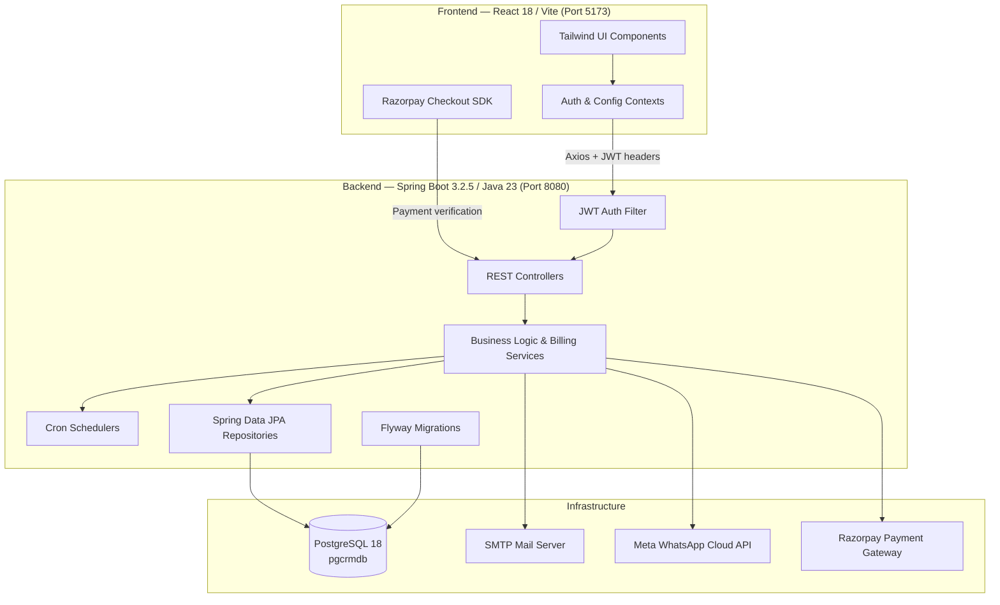

# PG CRM System Architecture

This document defines the system architecture for the **PG CRM** single-tenant Paying Guest & Hostel Management Platform.

---

## 1. System Overview

PG CRM is a **single-tenant** property management application. Each PG client (hostel operator) runs an independent, fully isolated stack comprising its own Spring Boot backend and PostgreSQL database. There is no shared schema between clients — physical database isolation makes cross-client data leaks impossible.

### Spatial Hierarchy

```
Building → Floor → Block → Room → Bed
```

Each property is modelled as a hierarchical tree. A `Building` contains `Floor`s, each `Floor` contains `Block`s or `Room`s directly, each `Room` contains `Bed`s. Bed occupancy states are `VACANT`, `OCCUPIED`, and `UNDER_NOTICE`.

### Deployment Model

One PG client = one isolated containerised stack:
- One Spring Boot backend (port `8080`)
- One React/Vite frontend (port `5173`)
- One dedicated PostgreSQL database (`pgcrmdb`)

---

## 2. Role & Access Model

The application enforces a strict Role-Based Access Control (RBAC) hierarchy with four roles:

| Role | Platform Tier | Access Scope & Responsibilities |
| :--- | :--- | :--- |
| `GUEST` | Tier 1 — Resident | Self-service portal: view check-in details, meal calendars, invoices, payment history, and submit maintenance requests. |
| `PG_MANAGER` | Tier 2 — Branch Admin | Property operations: guest check-in/checkout, daily meal logs, electricity bill splits, invoice generation, maintenance ticket resolution. |
| `PG_OWNER` | Tier 3 — Global Admin | Enterprise management: building/room/bed setup, manager account management, pricing configuration, revenue reports. |
| `SUPER_ADMIN` | Tier 4 — System Admin | Infrastructure operations: system-level configuration, whitelabel settings, production deployment management. |

RBAC is enforced at the Spring Security layer. See [AGENTS.md](file:///e:/PG-Project/AGENTS.md) for the full URL-to-role mapping table.

---

## 3. Tech Stack



**Backend stack**: Java 23, Spring Boot 3.2.5, Spring Security, Spring Data JPA, Hibernate, Flyway, OpenPDF, Thymeleaf, Lombok.

**Frontend stack**: React 18, Vite, Tailwind CSS, Axios, Razorpay SDK.

---

## 4. Key Business Logic

### 4.1 Flat-Rate Billing Model

PG CRM uses a **flat-rate monthly billing** model — no daily proration for active guests:

- **Standard Bed**: `Charge = guest.getMonthlyRent()`
- **Whole Room Booking**: `Charge = guest.getMonthlyRent() × room.getSharingType()`

If a guest is active for any part of a billing month, they are billed the full monthly rate. This is enforced by `MonthlyBillingScheduler`.

### 4.2 Electricity Bill (EB) Split Methods

The EB split method is configured per building via `BuildingConfig.getEbSplitMethod()`:

| Method | Formula |
| :--- | :--- |
| `EQUAL_SPLIT` | `perGuestShare = totalBillAmount / activeGuestCount` |
| `PER_BED` | `perGuestShare = fixedRatePerBed × guestBedCount` |
| `METER_BASED` | `perGuestShare = (currentReading − previousReading) × ratePerUnit` |
| `MANAGER_MANUAL` | Manager enters each guest's amount individually via the UI |

### 4.3 PII Anonymization Scheduler

Guests who have been checked out for more than **365 days** are automatically anonymized by `DataRetentionScheduler`:

- `fullName` → replaced with a random token
- `phone` → replaced with a random token
- **Financial records, invoices, and audit logs are preserved — never deleted**

Scheduler runs daily at **3:00 AM** (`0 0 3 * * ?`).

---

## 5. Security Architecture

### 5.1 JWT Authentication Flow

1. Client POSTs credentials to `/api/auth/login`.
2. Backend verifies BCrypt password hash and issues:
   - **Access Token** (15-minute expiry, HMAC-SHA256 signed)
   - **Refresh Token** (7-day expiry)
3. Client stores tokens in `sessionStorage`.
4. On API calls, the `JwtAuthenticationFilter` validates the Bearer token and extracts role claims.
5. On `401` responses, `AuthContext.jsx` silently POSTs the refresh token to `/api/auth/refresh` and replays the original request.

### 5.2 RBAC URL Patterns

| URL Pattern | Required Role |
| :--- | :--- |
| `/api/auth/**` | Public (except `/api/auth/change-password`) |
| `/api/super-admin/**` | `SUPER_ADMIN` |
| `/api/owner/**` | `PG_OWNER`, `SUPER_ADMIN` |
| `/api/manager/**` | `PG_MANAGER`, `PG_OWNER`, `SUPER_ADMIN` |
| `/api/guest/**` | `GUEST`, `PG_MANAGER`, `PG_OWNER`, `SUPER_ADMIN` |
| `/api/reports/**` | `PG_OWNER`, `PG_MANAGER`, `SUPER_ADMIN` |
| `/api/inventory/**` | `PG_MANAGER`, `PG_OWNER`, `SUPER_ADMIN` |
| `/api/payments/**` | `PG_MANAGER`, `PG_OWNER`, `SUPER_ADMIN` |
| `/api/webhooks/**` | Public (Razorpay webhook) |
| `/api/config/public` | Public (frontend branding) |

### 5.3 Razorpay Webhook HMAC-SHA256 Verification

All incoming Razorpay webhook payloads are cryptographically verified before processing:

$$\text{Expected Signature} = \text{HMAC-SHA256}(\text{rawPayload},\ \text{RAZORPAY\_WEBHOOK\_SECRET})$$

If the computed signature does not match the `x-razorpay-signature` header, a `SignatureVerificationException` is thrown (HTTP 400) and the request is rejected.

---

## 6. Scheduler Jobs

| Scheduler Class | Cron Expression | Trigger Time | Purpose |
| :--- | :--- | :--- | :--- |
| `MonthlyBillingScheduler` | `0 0 0 1 * *` | 1st of every month, midnight | Generates arrears rent invoices for all active guests |
| `PaymentReminderScheduler` | `0 0 9 * * *` | Daily at 9:00 AM | Notifies guests and managers of pending unpaid invoices |
| `DataRetentionScheduler` | `0 0 3 * * ?` | Daily at 3:00 AM | Anonymizes PII for guests checked out >365 days |
| `OverdueInvoiceScheduler` | Daily | Daily | Marks invoices past their due date as overdue |
